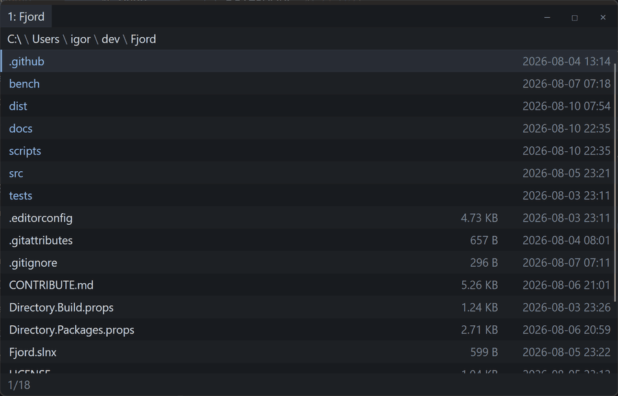

# Fjord

A fast, keyboard-first file manager: Vim's modal interaction over a native desktop app.

Built for people who would rather type `d3j` than reach for a mouse, but who still want
progress bars, a trash that works, and a window that behaves like the rest of the desktop.

[](https://github.com/ekoori/Fjord/actions/workflows/ci.yml)



*A listing, visual mode, the command line completing, a fuzzy search, the inside of a
zip, recursive folder sizes, and the help page. Regenerate with
`scripts/capture-screenshots.ps1` and `scripts/make-gif.py`.*

> **Status: early but complete for v1.** Everything on the original v1 list is built.
> Previews, an embedded terminal, git integration and plugins are not. The first
> packaged build is [v0.1.0-beta.1](https://github.com/ekoori/Fjord/releases/latest).

## What works

- **Modal navigation.** `hjkl`, `gg`/`G`, counts (`5j`), `Ctrl-f`/`Ctrl-b`, visual mode.
- **Operators with motions.** `d3j` trashes three rows, `y2j` yanks two. Counts multiply
  the vim way, so `3d2j` covers six.
- **File operations.** Copy, move, rename, duplicate, trash, mkdir, touch — queued,
  cancellable, with progress, and **undoable** with `u`.
- **A real trash.** The Recycle Bin on Windows, the freedesktop spec on Linux.
- **Open with.** `Ctrl-o` hands the file to the system's own chooser — the one that can
  also change which application owns the type from then on.
- **Tabs** with `L`/`H`, and history with `Ctrl-h`/`Ctrl-l`.
- **Registers and quickmarks.** `"ay` collects into `"a`; `m` names the directory you are
  in and `:cd <name>` goes back to it. Quickmarks survive a restart.
- **Lockable tabs.** Pin a tab to its folder; navigating out opens a new one and follows it.
  Name them with `:tab-rename`, reorder by dragging.
- **Archives as folders.** Enter a `.zip` or `.tar.gz` and browse it. Yank something
  inside and paste it anywhere to extract it; `:extract` does the same by name.
- **Named listings.** `:sort` cycles through saved sort orders; `:listing-save` keeps one.
- **A `:` command line** with history and path completion.
- **Fuzzy search.** `/` narrows the listing to what matches: `dbp` finds
  `Directory.Build.props`. `Ctrl-/` puts the rest back.
- **Sessions.** Tabs, directories, cursor and selection come back when you reopen.
- **Scrapbooks.** Collect entries from anywhere into a virtual list and act on them together.
- **Live configuration.** Edit the YAML, save, and your keys rebind without a restart.
- **Folder sizes on demand.** `Ctrl-d` walks every folder in the listing and fills in
  the size column as each one finishes.
- **Roots.** `:roots` lists the drives with their labels, free space and filesystem, as
  entries you can walk into.
- **Large directories.** 100,000 entries paints its first screen in about 25 ms.

## Installing

Grab an archive from [the latest release](https://github.com/ekoori/Fjord/releases/latest).
One self-contained executable per platform. No runtime to install, nothing to unpack, no
installer — download, extract, run. About 50 MB, because the .NET runtime and the whole
rendering stack are inside it.

| | |
|---|---|
| Windows x64 | `fjord-<version>-win-x64.zip` |
| Linux x64 | `fjord-<version>-linux-x64.tar.gz` |
| macOS Apple Silicon | `fjord-<version>-osx-arm64.tar.gz` |
| macOS Intel | `fjord-<version>-osx-x64.tar.gz` |

```bash
tar -xzf fjord-0.1.0-beta.1-linux-x64.tar.gz
./Fjord
```

**macOS needs one extra step.** The binary is not signed or notarised, so Gatekeeper will
refuse to run it after a download. Clear the quarantine flag first:

```bash
xattr -d com.apple.quarantine ./Fjord
```

There is no `.app` bundle yet, so on macOS it runs from a terminal and shows up without a
proper dock name. macOS is also the one platform none of this has been tried on — see
[Platform support](#platform-support).

Verified on a bare `debian:bookworm-slim` container with neither .NET nor libicu present.

To build the archives yourself:

```bash
pwsh ./scripts/package.ps1
```

## Building

Requires the [.NET 10 SDK](https://dotnet.microsoft.com/download). Nothing else.

```bash
git clone https://github.com/ekoori/Fjord.git
cd Fjord
dotnet run --project src/Fjord.App
```

Runs on Windows, Linux and macOS. CI builds and tests on Windows and Linux; macOS is
untested — see [Platform support](#platform-support).

## Keys

Press `?` in the app for the full list, generated from the command registry so it is never
out of date.

| | |
|---|---|
| `j` `k` | move down / up |
| `gg` `G` | first / last entry |
| `l` `Enter` | open — a directory, or a file in its default application |
| `o` `Ctrl-o` | open with the default application / with one you pick |
| `h` `Backspace` | parent directory |
| `Space` | select, and advance |
| `v` | visual mode |
| `y` `x` | yank / cut — operators, so `y2j` takes three rows |
| `p` | paste |
| `d` | trash — an operator, so `d3j` takes four rows and `dd` takes one |
| `D` | trash the selection |
| `u` `Ctrl-r` | undo / redo |
| `/` `Ctrl-/` | search — narrows the listing / puts it back |
| `Ctrl-d` | measure every folder here, recursively |
| `S` `gs` | add to scrapbook / open it |
| `"a` | use register `a` for the next yank, cut or paste |
| `m` | name this directory as a quickmark |
| `c` `'` | `:cd ` — quickmarks and recent folders, then the filesystem |
| `F2` | rename, with the current name filled in |
| `Y` | copy the full paths to the system clipboard as text |
| `L` `H` | next / previous tab |
| `Ctrl-h` `Ctrl-l` | back / forward |
| `Ctrl-F2` | name this tab |
| `?` | help |
| `:` | command line |

Nothing is bound to permanent deletion. `:delete!` is the only route, and it cannot be
undone.

## Configuration

`:config` opens the file in your editor. Saving applies immediately — no restart, no
reload command.

Keys are rebindable in the `bindings:` section. A command starting with `:` opens the
command line holding that text instead of running it, which is how a key becomes a starting
point rather than a whole action:

```yaml
bindings:
  normal:
    "c": ":cd "                 # opens the line; you finish it
    "~": "cd ~/Downloads"       # no colon, so it just goes there
    "<F2>": ":rename {name}"    # {name}, {path} and {dir} fill themselves in
```

`:set` changes one setting without leaving the keyboard — `:set appearance.font_size 15`,
or `:set appearance.font_size` on its own to see what it is now. Tab completes the names.
Writes go into the file, comments and ordering intact, so what you see next time you open
it is what is actually in effect.

```yaml
appearance:
  font_size: 13
  colors:
    directory: "#8AB4F8"

listing:
  sort_key: name        # name | size | modified | extension
  show_hidden: false

bindings:
  normal:
    "j": "move-down"
    "<Ctrl+d>": "directory-sizes"
```

The file is generated with every setting documented and every default binding listed as
commented reference, so there is nothing to look up. `:config-path` says where it lives —
`%APPDATA%\Fjord` on Windows, `$XDG_CONFIG_HOME/fjord` on Linux,
`~/Library/Application Support/Fjord` on macOS.

Set `FJORD_CONFIG_DIR` to run an isolated instance without touching your real settings.

## Platform support

| | Build & tests | Trash | Restore from Fjord |
|---|---|---|---|
| Windows | CI | Recycle Bin | no — needs Explorer's own undo stack |
| Linux | CI | freedesktop spec | yes, and from your desktop's file manager |
| macOS | **untested** | `~/.Trash` | yes, but no Finder "Put Back" |

Fjord will not offer an undo it cannot deliver: trashing on Windows simply does not appear
on the undo stack.

## Design

Three decisions shape most of the code, and
[`docs/architecture.md`](docs/architecture.md) explains the rest:

**The file list is drawn, not composed.** No virtualizing panel, no control per row — just
`Render(DrawingContext)` over the visible rows. A frame costs what the window costs, not
what the directory costs, so 100,000 entries costs the same as ten.

**Operations record what they did, not what they were asked to do.** That is what lets undo
survive skipped conflicts, partial failures and cancellation: whatever got as far as being
recorded is exactly what needs reversing.

**Operators resolve their range by running the motion.** `d3j` runs `move-down` for real
and diffs the cursor, rather than modelling what each motion would do. Every motion becomes
a valid operator target the day it is added, and a test enforces that motions stay pure.

## Contributing

See [`CONTRIBUTE.md`](CONTRIBUTE.md). In short: `Fjord.Core` never references Avalonia,
commands are methods with a `[Command]` attribute whose parameters *are* their arguments,
and comments explain **why**.

```bash
dotnet build   # warnings are errors
dotnet test
```

## Licence

MIT — see [`LICENSE`](LICENSE).

Parts of the key-input and command layers were adapted from QuteSharp, a C# port of
[qutebrowser](https://github.com/qutebrowser/qutebrowser), which is GPL-3.0.
[`NOTICE.md`](NOTICE.md) records the attribution and the caveat that comes with it;
[`VENDORED.md`](VENDORED.md) lists every adapted file and every deliberate divergence.
